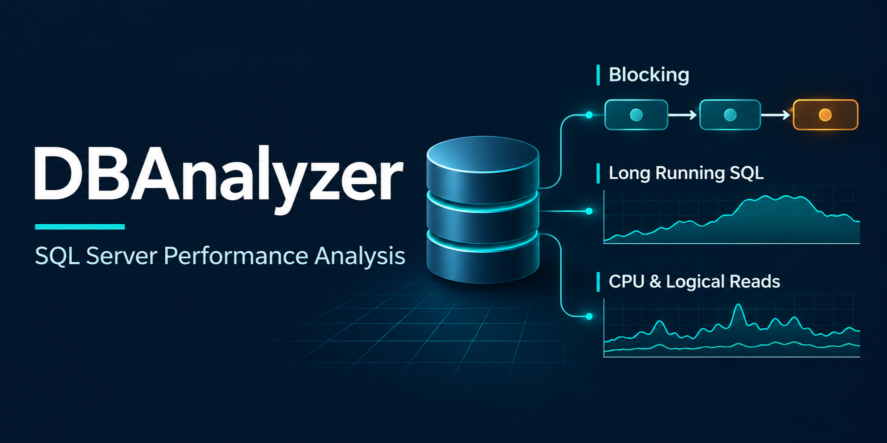

# DBAnalyzer GUI 部署



將整個 DBAnalyzer 資料夾複製到部署電腦，保留子資料夾結構。

監控物件集中在 `MS_PERF_COLLECTION`：`dbo` 保留 WhoIsActive 原始採樣與相關函式，`analyzer` 放置分析表、SP 與 View。原始採樣保留 7 天，分析資料保留含當天的 30 個日期。本套件提供全新安裝與目前架構的重複部署；舊版獨立 `DBAnalyzer` 資料庫需另行規劃資料搬移。

## 使用方式

1. 雙擊 **Deploy_GUI.cmd** 開啟部署視窗。
2. 在 **SQL Server Instance** 輸入目標，例如：
   - WIN2019LAB
   - WIN2019LAB\LAB2
   - tcp:192.168.56.202,1433
3. Lab 使用自簽憑證時，勾選 **Trust server certificate**。
4. 畫面會列出 **WhoIsActive、Blocking、LoginFailed、LongRunning、HighResource、TableRowCount、Maintance**。按 **Deploy** 依序佈署全部項目，下方會顯示執行進度及成功／失敗訊息。

使用目前 Windows 程序的帳號進行 Windows 驗證，該帳號須有 SQL Server sysadmin 權限。Instance 輸入框不會變更登入身分。

建議在 SQL Server VM 內使用 Administrator 開啟 GUI。若要從目前電腦使用 VM 帳號連線，可先執行：

```powershell
runas /netonly /user:WIN2019LAB\Administrator "powershell.exe -NoProfile -STA -ExecutionPolicy Bypass -WindowStyle Hidden -File C:\DBAnalyzer\Deploy_GUI.ps1"
```

輸入密碼後會開啟 GUI，不會將密碼存入檔案。在 Instance 輸入 VM IP，例如 tcp:192.168.56.202,1433。

## 檔案

|檔案|用途|
|---|---|
|Deploy_GUI.cmd|雙擊開啟 GUI|
|Deploy_GUI.ps1|Instance 輸入、部署按鈕、進度與結果畫面|
|Deploy.ps1|執行環境檢查及 SQL 的部署核心|
|Check_Environment.sql|SQL 環境檢查，可單獨於 SSMS 執行|

GUI 在背景執行 Deploy.ps1，不會顯示額外 PowerShell 視窗。執行期間按鈕與 Instance 輸入框會暫停操作，完成後恢復。詳細紀錄存於 DeploymentLogs，畫面底部也會顯示該次紀錄路徑。

功能與共用排程集中放在 `Features`：

```text
DBAnalyzer/
  Features/
    WhoIsActive/
    Blocking/
    LoginFailed/
    LongRunning/
    HighResource/
    TableRowCount/
    Retention/
    Jobs/
    Maintance/
  Deploy_GUI.cmd
  Deploy_GUI.ps1
  Deploy.ps1
  Check_Environment.sql
  AGENTS.md
  README.md
  DeploymentLogs/
```

## 部署順序

1. Features/WhoIsActive/Deploy_WhoIsActive.sql
2. Features/WhoIsActive/WhoIsActive_11_Deployment_In_Once.sql
3. Features/WhoIsActive/Deploy_WhoIsActiveJob.sql
4. Check_Environment.sql
5. Features/Deploy_AnalyzerSchema.sql
6. Features/Blocking/Deploy_DBAnalyzer_Daily.sql
7. Features/LoginFailed/Deploy_DBAnalyzer_LoginFailed.sql
8. Features/LongRunning/Deploy_DBAnalyzer_LongRunning.sql
9. Features/HighResource/Deploy_DBAnalyzer_HighResource.sql
10. Features/TableRowCount/Deploy_DBAnalyzer_TableRowCount.sql
11. Features/Retention/Deploy_DBAnalyzer_Retention.sql
12. Features/Jobs/Deploy_DBAnalyzer_Jobs.sql
13. Features/Jobs/Deploy_DBAnalyzer_CleanupJob.sql
14. Features/Maintance/_MaintanceJob.sql

SQL 發生錯誤會停止並顯示檔名與批次。已完成的 SQL 不會整套回滾，修正後可重新部署。部署時請避開排程執行時間。

## 前置條件

- Windows PowerShell 5.1 或更新版本，不需額外模組或 sqlcmd。
- SQL Server 2019 或更新版本，執行帳號有 sysadmin 權限。
- SQL Server Agent 已啟動。
- WhoIsActive 原始佈署檔須保留在套件中。首次安裝會建立收集環境；已有的收集 Job 必須啟用且具有啟用中的排程。
- 登入稽核包含 failed logins，目前解析版本使用英文 ERRORLOG。
- 維護腳本目前使用 `sa` 作為 Job 擁有者，該登入名稱必須存在。

套件在 MS_PERF_COLLECTION 建立 WhoIsActive 收集環境、analyzer Schema 分析物件及排程，也不立即重算日報。登入失敗收集使用應用程式執行鎖，避免收集與歷史清理同時執行。既有 WhoIsActive 表、SP 與收集 Job 保留，不覆寫原本的收集參數及頻率。

WhoIsActive 沿用提供的 v11.32 原始碼及授權。GUI 不直接執行整份舊版安裝檔，避免其中刪除資料表及重建 Job 的操作；也不執行舊版安裝檔中的輔助函式、測試採樣及既有資料庫設定變更。

## 排程

|功能|目標伺服器當地時間|
|---|---|
|WhoIsActive 收集（首次安裝預設）|每分鐘，保留 7 天|
|`_DBAnalyzer-Daily`：依序分析當天截至執行開始時的 Blocking、登入失敗、長時間 SQL、高資源 SQL|每日 00:00～23:59:59，每 10 分鐘|
|同一 Job 第 5 步：更新當天資料表估計筆數與容量快照|前四步成功後執行|
|`_DBAnalyzer-History-Cleanup`：12 張歷史表保留含當天的 30 個日期|每日 03:10|
|`_Maintenance.EveryDay`：MSDB 歷史清理及擁有者維護|每日 10:30，部署後啟用|
|`_BackupFull-Split`：完整備份|每日 01:00，部署後停用|
|`_BackupTransactionLog-Split`：交易記錄備份|每 15 分鐘，部署後停用|

`Features/Maintance/_MaintanceJob.sql` 沿用原始設定：部署會刪除並重建上述三個同名維護／備份 Job，因此會移除這些 Job 的既有歷史與自訂設定。每日維護執行時會清理 30 天前的 Job、備份還原與 Database Mail 歷史，並將符合條件的資料庫及 SQL Agent Job 擁有者改為 `sa`。Deploy.ps1 在執行維護腳本前會檢查這三個 Job；若正在執行或排隊，會停止並提示稍後重試。

兩個備份 Job 最後會被腳本停用，部署不立即執行備份或每日維護內容。備份預設使用 QNAP 模式、位址 `127.0.0.1`、共用名稱 `sqlbk`、檔案保留 7 天；啟用前請依環境調整腳本中的設定。Deploy.ps1 完成時會檢查每日維護 Job 已啟用，且兩個備份 Job 已停用。

分析 Job 每日 00:00～23:59:59 每 10 分鐘執行一次，分析當天 00:00 至各步驟執行開始時，起點包含、截止時間不包含；第 5 步取代當天快照，不保留每 10 分鐘的歷史快照。Job 有五個步驟，各自失敗最多重試 3 次、間隔 1 分鐘；仍失敗則停止 Job。部署會將既有 Blocking Job 改名並保留其歷史，移除原本 LoginFailed Job 及其 Job 歷史；`MS_PERF_COLLECTION.analyzer` 中的分析資料與執行紀錄保留。

登入失敗收集預設最多讀取 ERRORLOG 0～10，來源須涵蓋分析日期起點，讀取期間偵測到輪替則失敗並保留舊資料。成功收集時清除保留期間之外的明細與彙總；統一清理 Job 另清除過期執行紀錄。預設保留包含當天的 30 個日期；可使用 `@MaxArchiveNo` 與 `@RetentionDays` 調整。此次修改已在 WIN2019LAB 的獨立 tempdb 測試物件完成真實 ERRORLOG 與模擬異常驗證，並於 2026-10-20 部署至既有 DBAnalyzer，部署前後歷史筆數不變，詳見 `Features/LoginFailed/LoginFailed_Operations.md`。

長時間 SQL 預設門檻為 30 秒，將同一 Request 的採樣合併成一筆，排除閒置連線與系統背景工作。說明及手動執行範例見 `Features/LongRunning` 資料夾。

高資源 SQL 分別保留 CPU 及邏輯讀取量前 20 名，以同一 Request 的累計採樣最大值排名，不重複加總。說明及查詢範例見 `Features/HighResource` 資料夾。

資料表快照同時記錄中繼資料估計筆數及 UsedMB，統計所有使用者資料庫，排除 DBAnalyzer 與 MS_PERF_COLLECTION。UsedMB 包含本表各索引分割區的資料、索引與 LOB 已使用頁面。每天一份當下快照，分別計算筆數與容量的淨增減、平均每日淨增長；只有一份有效快照時平均為 NULL，舊快照缺少容量時不回填。說明及查詢範例見 `Features/TableRowCount` 資料夾。

`analyzer.vTableRowCountForecast` 使用最近 30 個日曆日期的有效筆數，線性估算最新快照之後 7 天及 30 天的筆數，並顯示快照數、觀察天數、快照距今天數及預測日期。資料不足或最新筆數未知時為 NULL，負的估算結果歸零。已於 2026-10-20 測試並部署至 WIN2019LAB；目前每張表僅有兩天快照，估算仍需搭配樣本跨度判讀。

WIN2019LAB 另建有 `TableRowCountTestLab.dbo.SampleRows`：SQL Server Agent 啟動時執行 `_DBAnalyzer-TestRows-Startup`，每次 SQL Server 啟動新增 1,000 筆並更新筆數快照，同次啟動重試不重複插入。此為獨立、可選的測試環境，部署檔與說明位於 `Features/TableRowCount/TestLab`；VM 從儲存狀態恢復且服務未重新啟動時，不會觸發。

## SQL 可讀性

分析 SP 以具名暫存表分開擷取、彙總、排名及寫入，登入錯誤標頭使用具名位置解析；每日 Job 將新建與既有步驟的共同設定集中在同一處。Blocking 樹與事件切段、分類規則、交易及錯誤處理保留必要邏輯，WhoIsActive 目錄不修改。

已使用同一份採樣快照比對 11 組新舊分析結果與執行計數；排除執行編號、流水號及執行時間後結果一致。另比對 Job 首次建立及既有 Job 更新後的步驟、擁有者、頻率、重試及失敗處理設定。

## 命令列方式

仍可直接執行部署核心：

```powershell
C:\DBAnalyzer\Deploy.ps1 -ServerInstance 'WIN2019LAB' -TrustServerCertificate
```

已驗證 GUI 的空白輸入檢查、Instance／憑證參數傳遞、背景執行、執行中關閉保護、成功與失敗狀態。每日分析已合併為一個 Job，歷史清除維持獨立 Job。統一清理說明見 `Features/Retention/Retention_Operations.md`。

午夜後排程轉看新的一天，上一日結果停留在最後一次更新時間，不自動補齊午夜前尾段。需完整歷史日報時，請在原始採樣清除前指定 `@AnalysisDate` 手動補跑。
